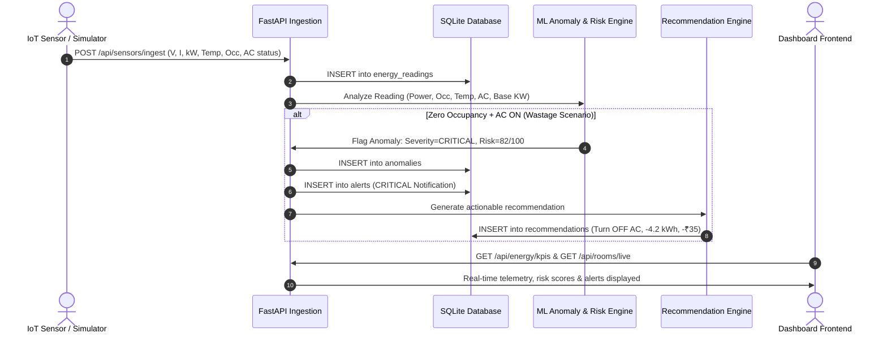
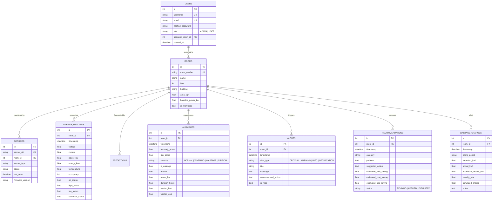

# PowerGuard AI: System Architecture & Technical Specifications

**AI-Powered Smart Energy Management System for Colleges, Hostels, and Multi-Room Institutional Facilities**

---

## 1. System Architecture Diagram

```mermaid
graph TD
    subgraph "Edge / Physical Layer"
        ESP32["ESP32 Microcontroller<br/>(CT Clamp, ZMPT101B, DHT22, PIR)"]
        Simulator["Realistic Multi-Room IoT Simulator<br/>(8 Facility Zones)"]
    end

    subgraph "Ingestion & API Gateway"
        Ingest["Telemetry Ingestion Endpoint<br/>POST /api/sensors/ingest"]
        FastAPI["FastAPI Backend Application<br/>(REST Controllers & Auth)"]
    end

    subgraph "Database Layer"
        DB[(SQLite / PostgreSQL Engine<br/>Relational Schema)]
    end

    subgraph "Machine Learning Intelligence"
        RF["Random Forest Regressor<br/>(MAE: 0.0331 kW, R²: 0.9987)"]
        IForest["Isolation Forest Anomaly Detector<br/>(Multi-variate Contamination: 6%)"]
        RiskEngine["Multi-Factor Risk Scorer<br/>(0–100 Scale & Explanation)"]
        Advisory["AI Recommendation Engine<br/>(kWh, ₹, CO₂ Savings)"]
    end

    subgraph "Simulation & Behavioral Engines"
        WhatIf["What-If Parametric Engine<br/>(Thermodynamics & Run Hours)"]
        SmartCharge["Simulated Smart Wastage Charge<br/>(Avoidable Excess × Penalty Rate)"]
    end

    subgraph "Frontend Presentation Layer"
        ReactApp["React 18 + Vite + TypeScript SaaS App<br/>(Executive Dashboard, Live Matrix, Room Inspection, Reports)"]
    end

    ESP32 -->|WiFi / MQTT / HTTP| Ingest
    Simulator -->|Thread Loop (5s)| Ingest
    Ingest --> DB
    Ingest --> IForest
    IForest --> RiskEngine
    RiskEngine --> Advisory
    Advisory --> DB
    
    FastAPI --> DB
    FastAPI --> RF
    FastAPI --> WhatIf
    FastAPI --> SmartCharge
    
    ReactApp <-->|REST API JSON + JWT| FastAPI
```

---

## 2. End-to-End Data Flow



---

## 3. Entity-Relationship (ER) Diagram



---

## 4. Machine Learning Pipeline

```mermaid
graph LR
    A[60-Day Hourly Dataset<br/>11,520 records] --> B[Feature Engineering<br/>Lags: 1h, 24h, Rolling 6h<br/>Cyclic Hour Sin/Cos<br/>Occupancy & Temp]
    B --> C[80/20 Chronological Split<br/>Train: 9,216 | Test: 2,304]
    C --> D[Random Forest Regressor<br/>Target: power_kw]
    C --> E[Isolation Forest<br/>Contamination: 6%]
    D --> F[Holdout Test Evaluation<br/>MAE: 0.0331 kW<br/>RMSE: 0.0664 kW<br/>R²: 0.9987]
    E --> G[Anomaly Classification<br/>& Outlier Scoring]
    F --> H[Joblib Serialization<br/>ml/models/*.joblib]
    G --> H
```

---

## 5. REST API Specifications

| Method | Endpoint | Description | Auth |
| :--- | :--- | :--- | :--- |
| `POST` | `/api/auth/login` | Authenticate with username & password; returns JWT | Public |
| `GET` | `/api/auth/me` | Fetch active user credentials and assigned room | Bearer |
| `GET` | `/api/energy/kpis` | Real-time aggregate KPI metrics (Today, Power, Cost, Savings, Risk) | Public |
| `GET` | `/api/energy/charts/hourly` | 24-hour historical & actual curve | Public |
| `GET` | `/api/energy/charts/daily` | 7-day daily consumption & cost trend | Public |
| `GET` | `/api/energy/charts/room-wise` | Current room-by-room load comparisons | Public |
| `GET` | `/api/energy/charts/appliance-wise`| Percentage load breakdown by appliance class | Public |
| `GET` | `/api/rooms/live` | Live telemetry status for all rooms with status badges | Public |
| `GET` | `/api/rooms/{id}` | Deep telemetry history, anomalies, and room recommendations | Public |
| `POST` | `/api/sensors/ingest` | Sensor telemetry ingestion endpoint; triggers AI analysis | Public / Token |
| `GET` | `/api/predictions/summary` | Actual vs Predicted comparisons, next-hour & next-day forecasts | Public |
| `GET` | `/api/anomalies/` | Historical and active wastage events with risk factors | Public |
| `GET` | `/api/alerts/` | Incident feed filterable by severity (CRITICAL, WARNING) | Public |
| `POST` | `/api/alerts/{id}/read` | Acknowledge and mark alert as read | Bearer |
| `GET` | `/api/recommendations/` | AI actionable advisory list with kWh, ₹, and CO₂ savings | Public |
| `POST` | `/api/recommendations/{id}/apply`| Execute and apply energy recommendation | Bearer |
| `POST` | `/api/simulation/run` | Parametric What-If simulation engine | Public |
| `GET` | `/api/wastage-charge/` | Departmental Simulated Smart Wastage Charge ledger | Public |
| `POST` | `/api/wastage-charge/calculate` | Custom avoidable excess charge calculation | Public |
| `GET` | `/api/reports/summary` | Executive daily, weekly, monthly consumption audit | Public |
| `GET` | `/api/reports/export/csv` | Stream real CSV energy report download | Public |
| `GET` | `/api/settings/` | Get configurable tariffs, CO₂ factors, and thresholds | Public |
| `PUT` | `/api/settings/update` | Update economic factors and threshold limits | Admin |
| `POST` | `/api/demo/scenario/{type}` | Switch presentation demo scenario (Normal, Wastage, Surge) | Public |
